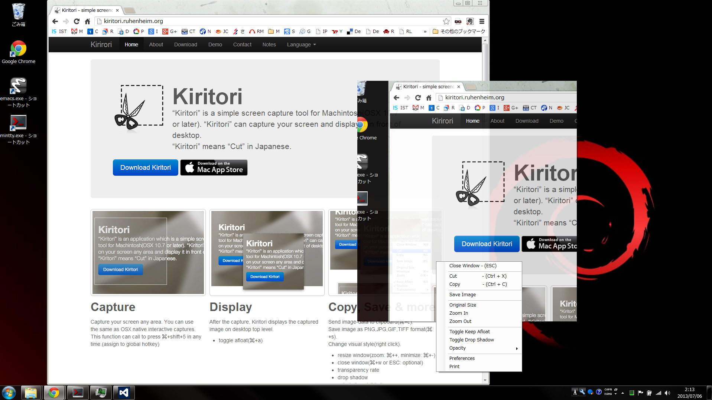

# Kiritori (Windows)

[Kiritori](https://kiritori.ruhenheim.org)

**Kiritori** は、デスクトップ上に切り出したスクリーンショットを“浮かせて”表示できる軽量ツールです。  
矩形キャプチャ、拡大縮小、透過、最前面固定、ドロップシャドウ、ショートカット操作、MS Paint 連携などをサクッと使えます。

> **EN**: Kiritori is a tiny screen capture tool for Windows that lets you capture any region and keep it floating on top. It supports zoom, opacity, drop shadow, always-on-top, rich hotkeys, and editing in MS Paint.

- “Kiritori” is a simple screen capture tool.
- “Kiritori” can capture your screen and display it in front of desktop.
- “Kiritori” means “Cut” in Japanese.

---

## ✨ 主な機能

- **矩形キャプチャ**（既定: `Ctrl`+`Shift`+`5` → 画面上をドラッグで範囲選択して最前面固定）
- **OCRキャプチャ**（既定: `Ctrl`+`Shift`+`4` → 画面上をドラッグで範囲選択してテキスト抽出）
- **ライブキャプチャ**（既定: `Ctrl`+`Shift`+`6` → 画面上をドラッグで範囲選択してリアルタイムプレビュー。タイトルバーは初期状態で非表示で、右クリックメニューから切り替え可能。設定は次回起動にも引き継がれます）
- **ライブ画像加工**（リアルタイム画面を右クリック →「画像加工」から加工なし／モザイク／セピア／グレースケールを選択。モザイクは弱・中・強の3段階で調整できます。画面全体に適用され、静止画保存・SnapWindow への取り込み・GIF／MP4 録画にも反映。一時停止中も切り替え可能。選択はウィンドウごとに保持され、新しい画面は加工なしで開始）
- **GPU キャプチャ**（Windows Graphics Capture を使用。`Auto` では利用できない環境や複数モニターにまたがる範囲を自動的に GDI へフォールバック）
- **ズーム**（拡大縮小 / マウスドラッグによる自由サイズ調整 / Shiftを押しながら縦横比率固定サイジング）
- **不透明度の切替**（100 / 90 / 80 / 50 / 30%）
- **クリップボード連携**（コピー / カット）
- **ファイル操作**（開く / 保存 / 印刷）
- **MS Paint で編集**（保存後、Kiritori 側に自動反映）
- **履歴管理**（タスクトレイに常駐しており右クリックメニューからも起動可能　過去にキャプチャした画像を再現可能）

---

## 🧰 インストール

### 1) バイナリから使う（推奨）
- **Releases** から最新の ZIP をダウンロードして展開 → `Kiritori.exe` を実行  
- Windows 10 バージョン 1809 以降（x64）と .NET Framework 4.8 が必要です

### 2) ソースからビルド

- Visual Studio 2022 と Windows 10/11 SDK をインストールします
- `Kiritori.sln` を開き、`Kiritori` プロジェクトを `Release | x64` でビルドします
- コマンドラインでは `msbuild Kiritori\Kiritori.csproj /t:Build /m /p:Configuration=Release /p:Platform=x64 /p:SignManifests=false` を実行します
- テストは `dotnet test Kiritori.Tests\Kiritori.Tests.csproj --configuration Release` で実行できます
- 加工の出力経路は、Release/x64 ビルド後に `powershell.exe -NoProfile -STA -File tools\Test-LiveFrameEffects.ps1` で検証できます（FFmpeg が必要）。実際のメニューとフレーム受信処理を使い、加工表示・GIF キュー・GIF／MP4 出力・停止中の加工解除を確認します。生成物は `Kiritori.Tests\TestResults\LiveFrameEffects` に保存されます。
- 録画の競合・GIF メモリ上限・終了時解放は `powershell.exe -NoProfile -STA -File tools\Test-LiveCaptureStability.ps1 -AssemblyPath Kiritori\bin\x64\Release\Kiritori.exe` で検証できます。GIF の待機中・処理中の元画像と蓄積済み画像には、合計512MiBの保持上限を適用します（画像加工やエンコードの一時領域を除く）。

MSIX の作成方法は [Package Build ワークフロー](.github/workflows/package.yml) を参照してください。

### ライブキャプチャの性能計測

- 描画処理: `dotnet run --project tools\LivePreviewPerfBenchmark\LivePreviewPerfBenchmark.csproj -c Release`
- キャプチャバックエンド: `dotnet run --project tools\LiveCaptureBackendBenchmark\LiveCaptureBackendBenchmark.csproj -c Release -- --target-fps 15`

GPU モードは 1 台のモニター内に収まる範囲で使用できます。`Auto`（推奨）は GPU を優先し、未対応環境・初期化失敗・キャプチャエラー時には GDI 互換モードへ切り替えます。

今回の変更内容は [v1.7.2 リリースノート](RELEASE_NOTES.md) を参照してください。

---

## 🎮 使い方（ショートカット）

| 操作 | キー |
|---|---|
| キャプチャ開始（範囲ドラッグ） | `Ctrl` + `Shift` + `5` |
| ウィンドウを閉じる | `Esc` / `Ctrl` + `W` |
| ウィンドウを最小化 | `Ctrl` + `H` |
| 画像を保存 | `Ctrl` + `S` |
| 画像を開く（ファイル） | `Ctrl` + `O` |
| 新規に開く（アプリ側の「Open」機能） | `Ctrl` + `N` |
| 印刷 | `Ctrl` + `P` |
| クリップボードにコピー | `Ctrl` + `C` |
| カット（コピーして閉じる） | `Ctrl` + `X` |
| 最前面固定の切替（Keep Afloat） | `Ctrl` + `A` |
| ドロップシャドウの切替 | `Ctrl` + `D` |
| 等倍（100%） | `Ctrl` + `0` |
| 拡大 / 縮小（±10%） | `Ctrl` + `+` / `Ctrl` + `-` |
| ウィンドウ移動（微調整） | ← / → / ↑ / ↓ |
| ウィンドウ移動（高速） | `Shift` + ← / → / ↑ / ↓ |

その他多数

> 右上にマウスを乗せると **× ボタン** が現れます。ホバー状態でクリックするとそのウィンドウを閉じます。

---

## 🖱 コンテキストメニュー（右クリック）

- **Capture** … 新規キャプチャを開始
- **File** … `Save Image` / `Open Image` / `Print`
- **Edit** … `Copy` / `Cut` / **Edit in Paint**
- **View** … `Original Size` / `Zoom In/Out` / `Zoom(%)`（10/50/100/150/200/500）/ `Opacity`（100/90/80/50/30）/ `Drop Shadow`
- **Window** … `Keep Afloat` / `Minimize`
- **Exit Kiritori** … アプリ終了

> **Edit in Paint** は現在表示中の画像を一時 PNG に保存して `mspaint.exe` で開きます。Paint を閉じると保存内容を自動で再読込します（PNG 透明は失われる場合があります）。

---

## 📸 スクリーンショット

